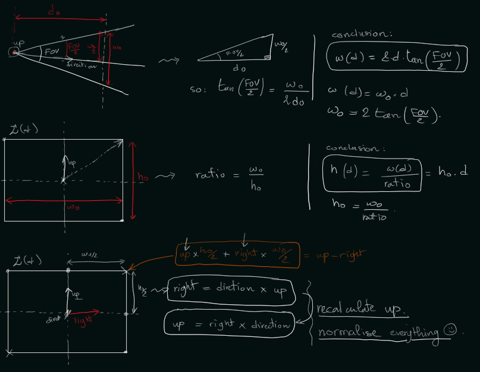
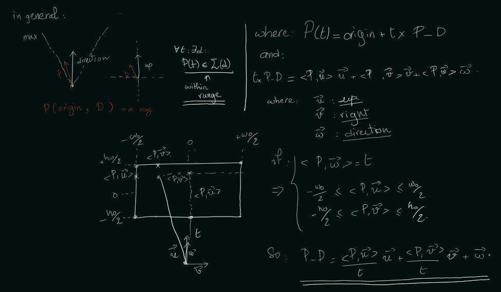

# Ray Tracing Project

This is my ray tracing implementation in Rust. I'm building a simple ray tracer that can render 3D scenes with spheres and basic lighting.

## What is Ray Tracing?

Ray tracing is a rendering technique where we simulate how light travels through a scene. Instead of trying to simulate light bouncing everywhere (which would be slow), we work backwards:

1. For each pixel on the screen, we shoot a ray from the camera through that pixel
2. We check what objects that ray hits
3. We calculate the color based on the object's material and lighting
4. We store that color in the pixel

This backwards approach is way faster than forward light simulation, and it still produces realistic images.

## How the Camera Works

The camera is responsible for generating rays—one ray per pixel on the screen. The key insight is **transforming pixel coordinates (2D screen space) into ray directions (3D world space)**.

### The Camera Coordinate System

The camera needs three orthogonal basis vectors to define its coordinate system:

- **Direction (D)**: Where the camera is looking
- **Right (R)**: Points to the right of the camera's view
- **Up (U)**: Points upward relative to the camera

These are calculated from the camera's input vectors:
- `D = direction` (forward-facing)
- `R = D × U` (perpendicular to direction and up, via cross product)
- `U' = R × D` (recalculated to ensure perfect orthogonality)

### Field of View and Viewport Size

The Field of View (FOV) determines how wide the camera's view is. Using the FOV angle:

$$\text{viewport\_height} = 2 \times \tan\left(\frac{\text{FOV}}{2}\right)$$

$$\text{viewport\_width} = \text{viewport\_height} \times \frac{\text{screen\_width}}{\text{screen\_height}}$$

This creates a virtual rectangle in 3D space that the camera "sees through." Rays through different pixels pass through different parts of this rectangle.


### Mapping Pixels to Ray Directions

For each pixel at screen coordinates `(x, y)`:

1. **Normalize to -1..1 range**:
   - `u = (x / width) × 2 - 1` (horizontal, -1 at left, +1 at right)
   - `v = -((y / height) × 2 - 1)` (vertical, inverted so top is positive)

2. **Calculate position on viewport**:
   $$\text{Ray Direction} = D + R \times \left(u \times \frac{w}{2}\right) + U' \times \left(v \times \frac{h}{2}\right)$$

   Where `w` = viewport_width and `h` = viewport_height



3. **Normalize the direction vector** to get a unit ray direction

4. **Create the ray**: `Ray(origin = camera_position, direction = normalized_direction)`

### Why This Works

Each pixel gets its own ray that passes through a unique point on the viewport. The camera's position is always the origin of every ray, but the direction changes based on which pixel we're rendering. This creates the perspective effect we expect from a camera.

The beauty of this approach is that:
- **Wide FOV** (large viewport) → rays spread out more → see more of the scene
- **Small FOV** (narrow viewport) → rays stay closer together → zoomed-in view
- **Aspect ratio** is preserved because viewport_width accounts for screen dimensions

## The Main Challenge: Ray-Sphere Intersection

The core of this project is figuring out if a ray hits a sphere. This is math-heavy, so let me break it down.

### The Setup

A **ray** is defined by two things:
- **Origin**: A starting point in 3D space (usually where the camera is)
- **Direction**: Which way the ray travels

Mathematically, any point on the ray can be expressed as:
```
P(t) = Origin + t × Direction
```

Where `t` is the distance along the ray (t=0 is the origin, t=1 is one unit away in the direction, etc.)

A **sphere** is defined by:
- **Center**: Its position in 3D space
- **Radius**: How big it is

Any point on the sphere's surface satisfies:
```
|P - Center|² = Radius²
```

### Solving for Intersection

To find where the ray hits the sphere, I substitute the ray equation into the sphere equation:

```
|Origin + t×Direction - Center|² = Radius²
```

Let me simplify by defining **A = Origin - Center** (the vector from the sphere's center to where the ray starts):

```
|t×Direction + A|² = Radius²
```

Now I expand the dot product (remember: |V|² = V·V):

```
(t×Direction + A) · (t×Direction + A) = Radius²
```

Distributing:

```
t²(Direction·Direction) + 2t(Direction·A) + A·A = Radius²
```

Rearranging to standard quadratic form **at² + bt + c = 0**:

```
t²(Direction·Direction) + 2t(Direction·A) + (A·A - Radius²) = 0
```

### The Coefficients

So my quadratic coefficients are:

- **a = Direction·Direction** — How much the direction vector "extends" in its own direction
- **b = 2(Direction·A)** — How the ray direction relates to the offset from sphere center
- **c = A·A - Radius²** — How far the ray start is from the sphere, minus the sphere's size

These aren't arbitrary—they fall out naturally from the geometry!

### Finding the Hit

Once I have a, b, and c, I calculate the discriminant:

```
Δ = b² - 4ac
```

- **If Δ < 0**: The ray misses the sphere (no real solutions to the equation)
- **If Δ ≥ 0**: The ray hits the sphere!

When there's a hit, I solve for t:

```
t = (-b - √Δ) / (2a)
```

I use the minus sign (not plus) to get the *closer* intersection point. If this t is positive, then the hit is in front of the camera, and I have a valid intersection.

### What I Return

When a ray hits, I need more than just "yes it hit"—I need:
- **t**: The distance along the ray to the hit point
- **point**: The actual 3D position where it hit = Origin + t × Direction
- **normal**: The surface normal (perpendicular to surface) = (point - center) / radius

The normal is crucial for lighting calculations later.

## Project Structure

```
raytracing/
├── src/
│   ├── main.rs       — Entry point and rendering loop
│   ├── vec3.rs       — 3D vector math
│   ├── ray.rs        — Ray representation
│   ├── sphere.rs     — Sphere and hit detection
│   └── camera.rs     — Camera positioning
└── Cargo.toml        — Project config
```

## Next Steps

- [ ] Implement Vec3 with all vector operations
- [ ] Implement Ray struct
- [ ] Implement Sphere with ray-sphere intersection
- [ ] Set up Camera
- [ ] Write main rendering loop
- [ ] Add lighting and colors
- [ ] Expand with more features (reflections, anti-aliasing, etc.)

## Resources

- [Ray Tracing in One Weekend](https://raytracing.github.io/) — The original inspiration
- [Rust Book](https://doc.rust-lang.org/book/) — For learning Rust concepts as I go
